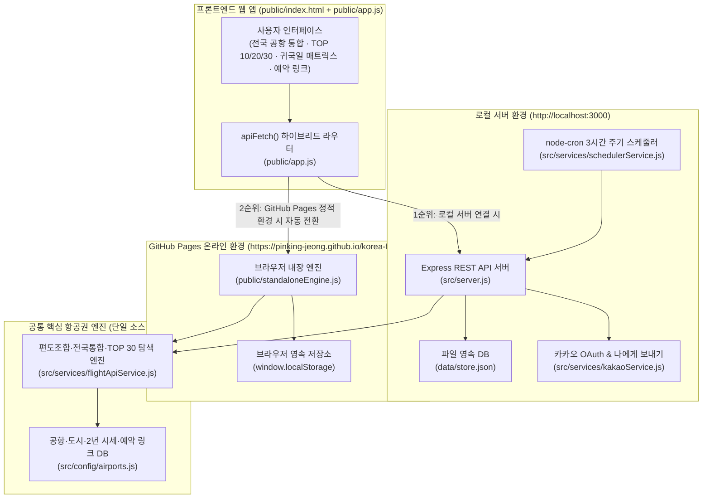

# 🛠️ 대한민국 출발 국제 항공권 최저가 알림 시스템 (SkyBell KR) 개발 및 유지보수 가이드

> **작성일**: 2026-10-18  
> **프로젝트 버전**: `v2.2.0` (전국 공항 통합 `ALL_KOREA` · TOP 10/20/30 3단 구분 · 원클릭 예약 링크 · GitHub 온라인 배포 버전)  
> **GitHub 저장소**: [https://github.com/pinking-jeong/korea-flight-alert](https://github.com/pinking-jeong/korea-flight-alert)  
> **온라인 웹 접속 주소 (GitHub Pages)**: [https://pinking-jeong.github.io/korea-flight-alert/](https://pinking-jeong.github.io/korea-flight-alert/)  
> **로컬 개발 서버 주소**: `http://localhost:3000`  
> **소스코드 받기**: `git clone https://github.com/pinking-jeong/korea-flight-alert.git`

---

## 1. 시스템 개요 및 아키텍처

**SkyBell KR**은 대한민국에서 출발하는 국제 항공권의 최저가를 찾기 위해 **기존 왕복 묶음 검색의 한계를 넘어 출국 편도(Outbound)와 귀국 편도(Inbound)를 각각 독립 탐색하여 합산(Mix & Match)**하고, **대한민국 전체 7개 국제공항(`ALL_KOREA`)을 동시에 포괄 스캔**하여 최저가 노선·일정·예약 링크·카카오톡 알림을 제공하는 웹 애플리케이션입니다.

### 1.1 하이브리드 듀얼 런타임 아키텍처 (Local Server + GitHub Pages Online)

본 프로젝트는 **로컬호스트 환경**과 **GitHub 온라인 환경(서버리스 정적 호스팅)** 양쪽에서 모두 100% 작동하도록 설계되어 있습니다.



- **동작 원리**:
  - [public/app.js](public/app.js)의 `apiFetch(url, options)` 함수가 먼저 백엔드 API(`/api/...`) 호출을 시도합니다.
  - 로컬 서버(`npm start`)가 켜져 있으면 Express 서버([src/server.js](src/server.js))가 응답합니다.
  - GitHub Pages 온라인 주소(`https://pinking-jeong.github.io/korea-flight-alert/`)로 접속하면 백엔드 서버가 없으므로 자동으로 `window.SkyBellStandaloneApi`([public/standaloneEngine.js](public/standaloneEngine.js))로 전환되어 브라우저 내에서 동일한 항공권 탐색 알고리즘과 `localStorage` DB를 실행합니다.

---

## 2. 지금까지 구현된 주요 기능 명세 (v1.0 ~ v2.2)

### ① 출항 공항 대한민국 전체 통합 (`ALL_KOREA`) 및 7대 국제공항 지원
- **지원 공항 코드**:
  - `ALL_KOREA`: **🇰🇷 한국 전체 공항 통합 (인천·김포·김해·청주·대구·제주·무안)**
  - 개별 공항: `ICN`(서울/인천), `GMP`(서울/김포), `PUS`(부산/김해), `CJJ`(청주), `TAE`(대구), `CJU`(제주), `MWX`(무안/광주)
- **전국 통합 탐색 로직**:
  - [src/config/airports.js](src/config/airports.js)의 `getEligibleKoreanOriginsForDestination(destMeta)`가 도착지 권역 및 직항 취항 여부에 따라 출발 가능한 한국 공항 후보군을 선별합니다.
  - 예: 하네다(`HND`)·송산(`TSA`)·홍차오(`SHA`)는 `GMP/ICN`, 장거리 유럽/미주 본토는 `ICN`, 일본/동남아/중화권 주요 도시는 전국 주요 공항(`ICN, PUS, CJJ, TAE, CJU, MWX`) 전체 비교.
  - 출국 공항과 귀국 공항이 서로 달라지는 불편을 막기 위해 **동일 한국 공항 왕복(출국 공항 = 귀국 공항)** 기준으로 편도 합산 최저가를 비교하여 가장 저렴한 한국 출발 공항을 선정합니다.

### ② 도시 미지정 향후 6개월(180일) 무조건 최저가순 `TOP 10` · `TOP 20` · `TOP 30` 3단 구분
- **구현 위치**: [src/services/flightApiService.js](src/services/flightApiService.js) 내 `getAnywhereTop10Next6Months()`
- **동작 방식**:
  - 전 세계 70개+ 기본 도시 및 사용자가 직접 추가한 모든 도시의 향후 180일(6개월) 일정을 스캔하여 도시별 가장 저렴한 최적 일정(1위)을 추출합니다.
  - 추출된 전체 노선을 **무조건 가장 싼 금액순(오름차순)**으로 정렬한 뒤 3개 티어(Tier)로 구조화합니다:
    - **🥇 TOP 10 (`1위 ~ 10위`)**: 초특가 최상위 그룹 (최저가·최고가·평균가 요약 배지 포함)
    - **🥈 TOP 20 (`11위 ~ 20위`)**: 가성비 단·중거리 인기 그룹 (`1~20위 누적 보기` 토글 지원)
    - **🥉 TOP 30 (`21위 ~ 30위`)**: 실속 중거리 노선 그룹 (`1~30위 누적 보기` 토글 지원)

### ③ 항공편별 원클릭 예약 링크 (`bookingLinks`) 제공
- **구현 위치**: [src/config/airports.js](src/config/airports.js) 내 `buildBookingLinks()` 및 `getAirlineOfficialBookingUrl()`
- **제공되는 링크 목록**:
  1. **출국 편도 네이버 예약 (`outboundNaverUrl`)**: 출국일·출발공항→도착공항·인원수(성인/소아/유아)·직항 여부가 자동 세팅된 네이버 편도 검색 딥링크
  2. **귀국 편도 네이버 예약 (`inboundNaverUrl`)**: 귀국일·도착공항→출발공항·인원수가 자동 세팅된 네이버 편도 검색 딥링크
  3. **출국/귀국 항공사 공식 홈페이지 (`outboundAirlineOfficialUrl`, `inboundAirlineOfficialUrl`)**: 제주항공, 진에어, 트리니티항공(옛 티웨이항공), 에어부산, 이스타항공, 에어프레미아, 에어로케이, 대한항공, 아시아나항공 등 45개+ 항공사 공식 홈페이지 직결 링크
  4. **통합 왕복 예약 링크 4종**:
     - `naverUrl`: 네이버 항공권 왕복 통합 검색
     - `skyscannerUrl`: 스카이스캐너 왕복 검색
     - `googleFlightsUrl`: 구글 플라이트 검색
     - `tripComUrl`: 트립닷컴(Trip.com) 항공권 검색

### ④ 지난 2년간(24개월) 시세 벤치마크 & 단일 출발일 귀국 매트릭스 & 유아 인원 계산
- **2년 시세 기준표 (`benchmark2Y`)**: 노선별 `2년 역대 최저가`, `상위 10% 특가 매수 기준선`, `2년 평균가`, `성수기 최고가`, `최저가 발생 비수기 월` 제공.
- **귀국 일정별 가격 매트릭스 (`getReturnDatePriceMatrix`)**: 특정 출발일 하나를 지정하면 `1박 2일`부터 `10박 11일`까지 귀국일별 오는편 편도 요금과 합산 요금을 막대그래프와 함께 한눈에 비교.
- **인원별 정밀 운임 계산 (`calculatePassengerPricing`)**:
  - 성인(만 12세 이상): `100%`
  - 소아(만 2세 ~ 11세, 좌석 점유): 성인 운임의 `80%`
  - 유아(만 24개월 미만, 성인 무릎 탑승): 성인 운임의 `10%` (항공사 안전 규정상 성인 1명당 유아 1명 제한 검증 포함)

---

## 3. 핵심 파일별 역할 및 코드 수정 가이드

앞으로 기능을 추가하거나 수정할 때 아래 파일별 가이드를 참고하세요.

| 파일 경로 | 핵심 역할 | 주요 함수 / 수정 포인트 |
| :--- | :--- | :--- |
| [src/config/airports.js](src/config/airports.js) | 한국 출발 공항(`ALL_KOREA` + 7개 공항), 해외 70개+ 도시 DB, 2년 시세, 예약 링크 생성 | `KOREAN_ORIGIN_AIRPORTS`, `INTERNATIONAL_DESTINATIONS`, `getEligibleKoreanOriginsForDestination()`, `buildBookingLinks()` |
| [src/services/flightApiService.js](src/services/flightApiService.js) | 편도 개별 탐색 및 합산, 향후 6개월 TOP 10/20/30, 귀국일 매트릭스, 추천 일정, ±3일 최저가, 목표가 일 단위 훑기, 운임 출처 3종(모의·실시간·최근 검색가)과 외부 후보 주입 | `computeOneWayCandidateOffers()`, `fetchLowestRoundTripPrice()`, `getAnywhereTop10Next6Months()`, `getReturnDatePriceMatrix()`, `getFlexibleDateDeals()`, `scanTargetPriceDeals()`, `rebuildExternalTargetScan()` — 고치면 `npm run sync:proxy` (7절) |
| [src/services/targetAlerts.js](src/services/targetAlerts.js) | 목표가 알림 한 곳: 입력 검증·기본값, 훑기(모의는 엔진, 실제 운임은 브라우저가 보낸 결과를 다시 검증), 카카오톡 보낼지 판단·문구·이력 (서버와 Pages 번들이 함께 씀 — 8절) | `createTargetAlert()`, `runTargetScan()`, `applyTargetScan()`, `shouldNotifyTargetAlert()`, `buildTargetAlertMessage()`, `enrichTargetAlert()` |
| [src/server.js](src/server.js) | Express REST API 엔드포인트 정의 및 3시간 주기 `node-cron` 백그라운드 가격 체크 | `/api/meta`, `/api/anywhere-top10`, `/api/return-date-matrix`, `/api/schedule-recommendations`, `/api/flex-dates`, `/api/target-alerts`, `/api/rules` |
| [public/index.html](public/index.html) | 프론트엔드 UI 레이아웃 (상단 폼·±3일 목록·목표가 알림 상자, 2년 시세판, 3개 탭 탐색기, 내 알림 대시보드, 카톡 미리보기) | 탭 버튼, 필터 셀렉트 박스, 모달 구조 수정 시 편집 |
| [public/app.js](public/app.js) | 프론트엔드 이벤트 핸들러, 카드 렌더링, 차트 렌더링, 하이브리드 `apiFetch()` | `renderAnywhereDealCardHtml()`, `renderReturnDateMatrix()`, `renderScheduleRecommendations()`, `renderWatchRules()` |
| [public/realFares.js](public/realFares.js) | PIN 실제 운임 모드 (app.js 다음에 읽힘): PIN 창, 운임 프록시 호출, 응답 정리, 실패 시 모의 가격 전환, 출처 표시 | `proxyFetch()`, `loadFareFeature()`, `fetchLiveExternalCandidates()`(날짜 지정 알림 재조회), `sanitizeProxyValue()` |
| [public/flexTargetUi.js](public/flexTargetUi.js) | ±3일 최저가 목록과 목표가 알림 화면 (realFares.js 다음에 읽힘): 등록·하루 한 번 자동 확인·다시 훑기·카드·카톡 미리보기 목록 | `handleFlexSearch()`, `loadFlexDeals()`, `handleCreateTargetAlert()`, `createTargetAlertFromDeal()`, `submitTargetAlert()`, `autoScanTargetAlerts()`, `targetAlertsListHtml()` |
| [public/menuRefresh.js](public/menuRefresh.js) | 메뉴별 `🔍 조회`(그 메뉴 값만 다시 불러옴)와 머리글 `🔄 전체 조회`(모든 메뉴 + 알림 일괄 조회) | `SECTION_REFRESHERS`(메뉴 → 로더), `refreshSection()`, `refreshAllSections()` |
| [proxy/](proxy) | 실제 운임 프록시 (별도 Vercel 프로젝트 `skybell-fare-proxy`): SerpApi·Travelpayouts 키를 숨기고 PIN 을 확인 | `lib/router.js`(경로), `lib/auth.js`(PIN 잠금), `lib/validate.js`(입력), `lib/serpapi.js`, `lib/travelpayouts.js`, `lib/fares.js`(운임 달력), `lib/top30.js` |
| [scripts/build-standalone.js](scripts/build-standalone.js) | GitHub Pages 온라인 작동용 번들(`public/standaloneEngine.js`) 생성 + `public/` → `docs/` 복사 | 백엔드 로직(`airports.js`, `flightApiService.js`) 또는 `public/` 수정 후 `npm run build:standalone` 실행 |
| [scripts/sync-proxy-engine.js](scripts/sync-proxy-engine.js) | 계산 엔진 사본을 `proxy/lib/engine/` 에 맞춤 | 엔진 수정 후 `npm run sync:proxy` (사본이 다르면 `npm test` 실패) |
| [test/verify.js](test/verify.js) · `test/*.test.js` | API·데이터 무결성 검증 + `node --test` 시험 (엔진·서버·Pages 번들·프록시·화면 로직, 가짜 상류 API `test/fixtures/fake-upstream.js`) | `npm test`로 실행 — 실제 키·네트워크 없이 돎 |

---

## 4. 자주 하는 유지보수 시나리오 (Step-by-Step)

### 시나리오 A: 새로운 해외 취항 도시를 기본 목록에 영구 추가하고 싶을 때
1. [src/config/airports.js](src/config/airports.js)의 `INTERNATIONAL_DESTINATIONS` 배열에 `makeDest({ ... })` 항목을 추가합니다:
   ```javascript
   makeDest({
     code: 'CTS',
     city: '삿포로 (신치토세)',
     country: '일본',
     region: '일본',
     avg2YKrw: 345000,
     lowest2YKrw: 168000,
     top10Deal2YKrw: 235000,
     peakHigh2YKrw: 650000,
     flightDuration: '2시간 40분'
   })
   ```
2. 터미널에서 온라인 번들 갱신 및 테스트를 실행합니다:
   ```powershell
   npm run build:standalone
   npm test
   ```

### 시나리오 B: 항공사 공식 홈페이지 링크를 추가·변경하고 싶을 때
1. [src/config/airports.js](src/config/airports.js) 하단의 `AIRLINE_OFFICIAL_URLS` 객체에 항공사명과 공식 URL을 추가합니다.
2. `npm run build:standalone`을 실행하여 GitHub Pages 번들에도 반영합니다.

### 시나리오 C: 수정한 내용을 GitHub 및 온라인(GitHub Pages)에 업데이트 배포할 때
코드 수정 후 아래 명령어 4줄만 실행하면 GitHub 저장소와 온라인 웹사이트(`https://pinking-jeong.github.io/korea-flight-alert/`)가 자동으로 최신화됩니다:

```powershell
# 1. 온라인용 Standalone 엔진 최신화 빌드 및 테스트
npm run build:standalone
npm test

# 2. Git 커밋 및 GitHub 원격 저장소 푸시
git add .
git commit -m "feat: 노선 및 항공권 탐색 기능 업데이트"
git push origin main
```
> **참고**: `main` 브랜치에 Push되면 `.github/workflows/deploy-pages.yml` GitHub Actions 워크플로우가 자동 실행되어 약 30~60초 내에 [https://pinking-jeong.github.io/korea-flight-alert/](https://pinking-jeong.github.io/korea-flight-alert/) 온라인 페이지에 즉시 반영됩니다.

---

## 5. GitHub 계정 및 배포 환경 정보

- **GitHub 계정**: `pinking-jeong`
- **GitHub Repository URL**: [https://github.com/pinking-jeong/korea-flight-alert](https://github.com/pinking-jeong/korea-flight-alert)
- **GitHub Pages 온라인 서비스 URL**: [https://pinking-jeong.github.io/korea-flight-alert/](https://pinking-jeong.github.io/korea-flight-alert/)
- **인증 방식**: `git push` 에는 이 저장소에 쓰기 권한이 있는 GitHub 인증이 필요합니다 (예: `gh auth login` 으로 GitHub CLI 로그인).

---

## 6. v2.3 모바일 최적화 및 메뉴별 접기/펼치기(Accordion) 구조 안내

### 6.1 메뉴별 접었다 폈다 (Accordion) 기능
- **적용 대상 7대 메인 섹션** (`ALL_SECTION_IDS`):
  1. `sectionKpi`: 상단 핵심 요약 지표 (KPI)
  2. `sectionSearchForm`: 출항지·도착지·인원(성인/소아/유아) 및 일정 설정, `🔍 ±3일 최저가 찾기` 목록, `🔔 목표가 알림 등록` 상자
  3. `sectionBenchmark2Y`: 최근 2년 최저가·평균가 벤치마크
  4. `sectionExplorer`: 최저가 일정 탐색기 (향후 6개월 TOP 10/20/30, 추천 일정, 귀국일 그리드)
  5. `sectionWatchlist`: 내 항공권 알림 목록 (위: 목표가 알림 · 아래: 이전 방식 날짜 지정 알림)
  6. `sectionPriceChart`: 편도 조합 합산 최저가 추이 차트
  7. `sectionKakaoPreview`: 카카오톡 알림톡 발송 미리보기 및 이력
- **핵심 제어 함수** ([public/app.js](public/app.js)):
  - `toggleSectionCollapse(sectionId, forceOpen)`: 개별 메뉴 헤더 클릭 시 해당 메뉴 본문(`#body_${sectionId}`)을 접거나 펼치며, 상태를 `localStorage` (`skybell_collapsed_sections_v23`)에 자동 저장합니다.
  - `refreshSection(sectionId)` ([public/menuRefresh.js](public/menuRefresh.js)): 메뉴 헤더의 `🔍 조회` 버튼(`#btnRefresh_${sectionId}`, `event.stopPropagation()` 으로 접기와 따로)으로 그 메뉴 값만 다시 불러오고, 접혀 있으면 펼칩니다. 노선·인원 설정의 조회는 고른 노선으로 ±3일 목록(펼쳐 둔 경우)·시세표·탐색기 세 탭·가격 추이를 다시 부르고(그 메뉴는 펼치지 않음), 알림 목록의 조회는 알림 일괄 조회입니다(목표가 알림은 Travelpayouts 로 다시 훑고, 실제 운임 모드에서 날짜 지정 알림이 있으면 그것만 SerpApi 횟수를 확인 창으로 묻습니다). 실제 운임 모드의 시세표 조회는 같은 노선이어도 저장해 둔 결과를 버리고 다시 받아 옵니다.
  - `refreshAllSections()`: 상단 `🔄 전체 조회` — 모든 메뉴 값과 알림 일괄 조회를 함께 돌리고(메뉴는 펼치지 않음) 결과를 토스트 하나로 알립니다. 메뉴를 새로 만들면 `SECTION_REFRESHERS` 에 그 메뉴의 로더를 넣으세요.
  - `expandAllSections()` / `collapseAllSections()`: 상단 바의 `📂 전체 메뉴 펼치기` / `📁 전체 메뉴 접기` 버튼으로 7개 메뉴 전체를 일괄 제어합니다.
  - `toggleTierGroupCollapse(tierKey)`: 6개월 최저가 탐색기 내부의 `🥇 TOP 10 (1~10위)`, `🥈 TOP 20 (11~20위)`, `🥉 TOP 30 (21~30위)` 각 그룹 헤더를 개별적으로 접고 펼칩니다.
  - `toggleRuleDetailCollapse(ruleId)`: 등록된 각 알림 규칙 카드 내부의 편도 조합 및 예약 링크 영역을 `상세·예약 접기 ▲ / 펼치기 ▼`로 여닫습니다.

### 6.2 모바일 화면 최적화 (Mobile-First UI)
- **상단 퀵 컨트롤 바**: 가로 스크롤 가능한 칩 바(`no-scrollbar`)를 통해 모바일에서도 전체 펼치기/접기 및 원하는 메뉴로 즉시 이동(`jumpToSection`)할 수 있습니다.
- **모바일 하단 고정 내비게이션 바 (`md:hidden fixed bottom-0`)**: 스마트폰 한 손 조작을 위해 `🔔 노선설정`, `🏆 TOP 30`, `🗓️ 귀국일표`, `📋 내알림`, `💬 카톡/차트` 5개 탭을 하단에 고정 배치했습니다. 해당 탭을 누르면 접혀 있던 메뉴도 자동으로 펼쳐지며 해당 위치로 부드럽게 스크롤됩니다.
- **2열 컴팩트 그리드 & 1줄 인원 선택기**: 모바일 화면에서 스크롤 길이를 줄이기 위해 KPI 요약 카드와 2년 가격 기준표를 2열 그리드로 배치하고, 성인/소아/유아 인원 선택기를 3열 1줄 컴팩트 컨트롤로 최적화했습니다.

---

## 7. v2.4 PIN 실제 운임 모드 (운임 프록시)

운영 방법(키 넣기·PIN 바꾸기·한계)은 [REAL_FARES.md](REAL_FARES.md) 에 있습니다. 여기서는 코드를 고칠 때 알아야 할 구조만 적습니다.

### 7.1 흐름
- 페이지는 PIN 을 넣기 전까지 예전과 똑같이 모의 가격으로 동작합니다. PIN 을 넣으면 [public/realFares.js](public/realFares.js) 가 `POST /api/session` 으로 PIN 을 확인하고, 이 탭의 `sessionStorage` 에만 PIN 을 둡니다(주소·`localStorage` 에는 넣지 않음).
- 이후 조회는 `X-Access-Pin` 머리글을 붙여 운임 프록시(`https://skybell-fare-proxy.vercel.app`)로 갑니다. 프록시가 SerpApi·Travelpayouts 를 부르고, 키는 프록시의 Vercel 환경 변수에만 있습니다.
- 기능별 공급자: TOP 30 · 노선 시세(앞으로 12개월) · 귀국일표 · 추천 일정 · 가격 추이 · ±3일 최저가 · 목표가 알림은 Travelpayouts(`TRAVELPAYOUTS_PRICES`, 화면 `최근 검색가`), 이전 방식 날짜 지정 알림의 재조회 · 일괄 조회만 SerpApi(`SERPAPI_GOOGLE_FLIGHTS`, 화면 `실시간`). 새 기능에서 SerpApi 를 부르지 마세요(월 250회).

### 7.2 코드를 고칠 때
- **프록시 응답은 그대로 화면에 넣지 않습니다.** `proxyFetch()` 가 `sanitizeProxyValue()` 로 글자(`<>"'&` 등)·URL(https 만)·숫자 필드를 정리합니다. 새 필드를 화면에 쓸 때도 `escapeHtml()` 을 거치세요.
- **실패는 기능 단위로 모의 가격에 넘깁니다.** 새 조회 기능은 `loadFareFeature(route, params, loadSimulated)` 로 감싸면 실패 이유가 `realFareFallback` 으로 붙어 화면에 표시됩니다. 재조회처럼 저장된 값을 바꾸는 동작은 실패하면 모의 값으로 덮어쓰지 말고 멈춥니다.
- **모의 경로 문자열은 app.js · flexTargetUi.js 에 그대로 둡니다.** `test/standalone.test.js` 가 두 파일의 `apiFetch('/api/...` · `postJsonToApp('/api/...` 문자열을 찾아 Pages 엔진에 같은 경로가 있는지 확인합니다.
- **엔진을 고치면 `npm run sync:proxy`.** 프록시는 같은 계산(엔진 사본 `proxy/lib/engine/`)에 실제 운임 달력을 넣어 귀국일표·추천·추이를 만듭니다.
- 운임 출처 문구 함수 `describeFareSource` 는 [public/app.js](public/app.js) 와 엔진 [src/services/flightApiService.js](src/services/flightApiService.js) 에 같이 있으니 함께 고칩니다 (엔진 쪽은 고친 뒤 `build:standalone`·`sync:proxy`).

### 7.3 배포
- 페이지: 예전처럼 `npm run build:standalone` → `npm test` → `main` 에 푸시 (`docs/realFares.js`·`docs/flexTargetUi.js`·`docs/menuRefresh.js` 포함).
- 프록시: `proxy/` 폴더에서 `vercel deploy --prod` (Vercel 프로젝트 `skybell-fare-proxy`). 환경 변수를 바꾼 뒤에도 다시 배포해야 반영됩니다. 새 프록시 경로를 쓰는 페이지는 프록시를 먼저 배포한 뒤 올립니다.
- PIN·키는 저장소에 넣지 않습니다. 시험은 더미 PIN 과 가짜 상류 API 로 돌아갑니다.

---

## 8. v2.5 ±3일 최저가 · 목표가 알림

### 8.1 ±3일 최저가 (노선·인원 설정)
- 엔진 `getFlexibleDateDeals()` 가 입력한 가는 날·오는 날을 각각 `flexDays`(최대 3)일 옮긴 조합에서 싼 순서로 `limit`(기본 20)개를 돌려줍니다. 오늘보다 앞선 가는 날, 가는 날과 같거나 앞선 오는 날은 뺍니다. 같은 값이면 입력 일정에 가까운 것이 먼저입니다.
- 모의: `GET /api/flex-dates`(서버·Pages 엔진). 실제 운임: 프록시 `flex-dates` 가 Travelpayouts 운임 달력을 같은 엔진(사본)에 넣어 계산합니다. 화면은 `loadFlexDeals()` 가 `loadFareFeature('flex-dates', …)` 로 부르고, 늦게 온 이전 응답은 버립니다.
- 프록시는 가는 날 ±3일·오는 날 ±3일이 걸친 달만 받습니다(달마다 가는 편·오는 편 2회). 긴 여행이어도 그 사이 달은 받지 않습니다.
- 화면: 오류는 요약 칸(`#flexResultsSummary`)에 보이고 목록은 비웁니다. 화면 읽기 프로그램에는 결과 상자 밖에 늘 있는 `#flexResultsStatus`(`sr-only`, `role="status"`)에 한 줄로 알립니다 — 숨긴 상자 안의 알림 칸은 상자를 여는 순간 채워지면 읽히지 않기 때문입니다. 줄을 펴고 접을 때는 목록만 다시 그리고 누른 버튼에 초점을 돌려줍니다(`focusRowToggle`, 버튼의 `data-row-toggle`). 메뉴 조회·PIN 전환은 마지막으로 찾기 시작한 조건(`flexLatestQuery`)으로 다시 찾습니다.

### 8.2 목표가 알림 (날짜 없이 희망 목표가만)
- 저장소 `targetAlerts` 배열(서버 `data/store.json`, Pages `localStorage`)에 둡니다. 규칙: 내일(KST)부터 `windowDays`(7~186, 화면 30·60·90·180, 기본 90)일, `minNights`~`maxNights`(1~30, 화면 1~14, 기본 2~5박), 목표가 1,000~2천만 원(화면 최소 1만 원), 출발일마다 1건·최대 20건, 카카오톡 알림 간격 기본 12시간.
- 경로: `POST /api/target-alerts`(등록 + 바로 훑기) · `POST /api/target-alerts/:id/scan` · `POST /api/target-alerts/:id/notify` · `DELETE /api/target-alerts/:id` · `DELETE /api/target-alerts`. 목록은 `GET /api/dashboard` 의 `targetAlerts` 로 옵니다.
- 실제 운임: 브라우저가 프록시 `target-scan`(Travelpayouts)을 받아 `scanResult` 로 보내면 `targetAlerts.js` 가 일정·편도·가격을 다시 검증하고 예약 링크를 새로 만듭니다(브라우저 값은 믿지 않음). 받아 줄 수 없으면 422(`BAD_FARE_SOURCE`·`NO_REAL_FARES`)이고 화면은 모의 가격으로 다시 등록하며 이유를 보여 줍니다. 실제 운임 알림을 `scanResult` 없이 훑으면 409 `REAL_FARE_NEEDS_PIN` — 모의 가격으로 덮어쓰지 않습니다.
- 자동 확인: 화면은 앱을 열 때(`initApp`)와 PIN 을 넣었을 때 `autoScanTargetAlerts()` 로 오늘 아직 훑지 않은 알림을 차례로 훑습니다. 서버 정기 조회(`schedulerService`)는 모의 가격 알림만 훑고 실제 운임 알림 수를 `skippedRealFareTargetAlerts` 로 알려 줍니다. 앱을 열지 않아도 실제 운임으로 매일 훑으려면 서버 쪽 예약 실행(예: Vercel Cron + 저장소 + 서버용 카카오 토큰)이 따로 필요합니다.
- 카드의 `🎯 목표가 알림`(TOP 30·귀국일표·추천)과 ±3일 목록의 `🎯 이 가격 이하 알림` 은 `createTargetAlertFromDeal()` 로 그 가격을 목표가로 등록합니다(기간은 그 일정이 들어가는 가장 짧은 선택지, 박수는 그 일정을 포함하도록).
- 이전 방식 날짜 지정 알림(`watchRules`)은 화면에서 새로 만들지 않지만 목록·재조회·카톡·삭제는 그대로이고 API `POST /api/rules` 도 남아 있습니다. 실제 운임 모드에서 한 건을 다시 조회할 때도 SerpApi 남은 횟수를 확인 창으로 묻습니다(`confirmLiveRecheck`).
- 검증 세부: 도착지에 한국 공항은 고를 수 없습니다(400 `BAD_TARGET_ALERT`). 받은 최근 검색가가 알림의 노선·날짜·조건과 하나도 맞지 않으면 422 `NO_REAL_FARES` 이고, 일부만 맞으면 맞는 것만 씁니다(직항 알림에 온 경유 편은 버림). 이상한 검색한 날(`searchedOn`)·수집 시각(`fetchedAt`, 8일보다 오래됐거나 미래)은 비웁니다. 목표가 이하 일 수(`matchCount`)는 보낸 목록이 20건을 채웠을 때만 프록시 값을 씁니다.
- 저장: 일정(`matches`·`cheapest`)에는 예약 링크를 두지 않고(`withoutRoundTripLinks`), 보여 줄 때·카톡을 보낼 때 `withRoundTripLinks()` 로 다시 만듭니다 — 알림 한 건이 절반 이하로 줄어 Pages `localStorage` 한도를 덜 씁니다.
- 화면: 등록이 끝나기 전에 또 누르면 보내지 않습니다(`targetAlertSubmitting`, 버튼 `⏳ 등록 중…`). ±3일 목록의 알림은 목록을 찾은 조건(직항·인원)으로 등록하고, 카드 일정이 훑는 범위(내일부터 최대 180일·30박) 밖이면 등록 안내에 그 사실을 붙입니다. 실제 운임 알림을 다시 훑다가 프록시가 실패하면 앱에 보내지 않고 지난 결과를 그대로 둡니다. 같은 알림을 겹쳐 훑지 않고(`targetAlertBusy`), 자동 확인도 겹쳐 돌지 않습니다.

### 8.3 저장·실행 안전
- 로컬 서버는 저장소를 읽고 고치는 경로(알림·목표가 알림·카톡·설정·일괄 조회·카카오 로그인)와 3시간 정기 조회를 `withStoreLock()`([src/storage/db.js](src/storage/db.js))으로 한 줄로 세웁니다 — 정기 조회가 카톡을 보내는 사이에 등록한 알림이 덮여 사라지지 않게. 새 쓰기 경로는 [src/server.js](src/server.js) 의 `storeWrite(...)` 로 감싸고, 그 안에서 다시 잠그지 마세요(멈춥니다).
- 정기 조회·일괄 조회는 노선 하나가 실패해도 나머지를 계속하고, 실패한 수와 첫 이유를 돌려줍니다(`failedGroups`·`failedTargetAlerts`·`failureReason`, 이유는 120자까지) — 화면은 '완료' 대신 ⚠️ 와 이유를 보여 줍니다. 잠금 안에서 부르는 외부 요청은 시간 제한을 둡니다: 카카오(토큰·메시지) `KAKAO_TIMEOUT_MS`, Amadeus `AMADEUS_TIMEOUT_MS` 모두 15초.
- Pages 판은 `localStorage` 저장이 실패하면(용량 초과·막힘) 507 `STORAGE_FULL` 로 알려 저장된 것처럼 보이지 않게 합니다.

