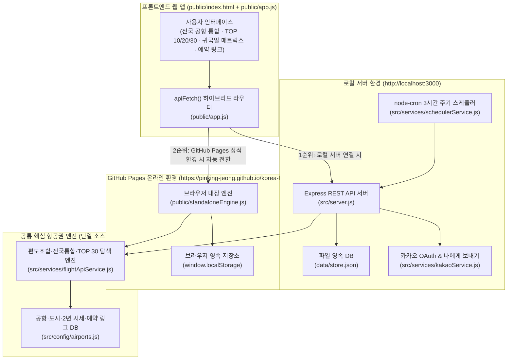

# 🛠️ 대한민국 출발 국제 항공권 최저가 알림 시스템 (SkyBell KR) 개발 및 유지보수 가이드

> **작성일**: 2026-10-18  
> **프로젝트 버전**: `v2.2.0` (전국 공항 통합 `ALL_KOREA` · TOP 10/20/30 3단 구분 · 원클릭 예약 링크 · GitHub 온라인 배포 버전)  
> **GitHub 저장소**: [https://github.com/pinking-jeong/korea-flight-alert](https://github.com/pinking-jeong/korea-flight-alert)  
> **온라인 웹 접속 주소 (GitHub Pages)**: [https://pinking-jeong.github.io/korea-flight-alert/](https://pinking-jeong.github.io/korea-flight-alert/)  
> **로컬 개발 서버 주소**: `http://localhost:3000`  
> **로컬 소스코드 경로**: [korea-flight-alert](file:///C:/Users/geniu/Documents/Obsidian%20Vault/Using%20Antigravity/korea-flight-alert)

---

## 1. 시스템 개요 및 아키텍처

**SkyBell KR**은 대한민국에서 출발하는 국제 항공권의 최저가를 찾기 위해 **기존 왕복 묶음 검색의 한계를 넘어 출국 편도(Outbound)와 귀국 편도(Inbound)를 각각 독립 탐색하여 합산(Mix & Match)**하고, **대한민국 전체 7개 국제공항(`ALL_KOREA`)을 동시에 포괄 스캔**하여 최저가 노선·일정·예약 링크·카카오톡 알림을 제공하는 웹 애플리케이션입니다.

### 1.1 하이브리드 듀얼 런타임 아키텍처 (Local Server + GitHub Pages Online)

본 프로젝트는 **로컬호스트 환경**과 **GitHub 온라인 환경(서버리스 정적 호스팅)** 양쪽에서 모두 100% 작동하도록 설계되어 있습니다.



- **동작 원리**:
  - [public/app.js](file:///C:/Users/geniu/Documents/Obsidian%20Vault/Using%20Antigravity/korea-flight-alert/public/app.js)의 `apiFetch(url, options)` 함수가 먼저 백엔드 API(`/api/...`) 호출을 시도합니다.
  - 로컬 서버(`npm start`)가 켜져 있으면 Express 서버([src/server.js](file:///C:/Users/geniu/Documents/Obsidian%20Vault/Using%20Antigravity/korea-flight-alert/src/server.js))가 응답합니다.
  - GitHub Pages 온라인 주소(`https://pinking-jeong.github.io/korea-flight-alert/`)로 접속하면 백엔드 서버가 없으므로 자동으로 `window.SkyBellStandaloneApi`([public/standaloneEngine.js](file:///C:/Users/geniu/Documents/Obsidian%20Vault/Using%20Antigravity/korea-flight-alert/public/standaloneEngine.js))로 전환되어 브라우저 내에서 동일한 항공권 탐색 알고리즘과 `localStorage` DB를 실행합니다.

---

## 2. 지금까지 구현된 주요 기능 명세 (v1.0 ~ v2.2)

### ① 출항 공항 대한민국 전체 통합 (`ALL_KOREA`) 및 7대 국제공항 지원
- **지원 공항 코드**:
  - `ALL_KOREA`: **🇰🇷 한국 전체 공항 통합 (인천·김포·김해·청주·대구·제주·무안)**
  - 개별 공항: `ICN`(서울/인천), `GMP`(서울/김포), `PUS`(부산/김해), `CJJ`(청주), `TAE`(대구), `CJU`(제주), `MWX`(무안/광주)
- **전국 통합 탐색 로직**:
  - [src/config/airports.js](file:///C:/Users/geniu/Documents/Obsidian%20Vault/Using%20Antigravity/korea-flight-alert/src/config/airports.js)의 `getEligibleKoreanOriginsForDestination(destMeta)`가 도착지 권역 및 직항 취항 여부에 따라 출발 가능한 한국 공항 후보군을 선별합니다.
  - 예: 하네다(`HND`)·송산(`TSA`)·홍차오(`SHA`)는 `GMP/ICN`, 장거리 유럽/미주 본토는 `ICN`, 일본/동남아/중화권 주요 도시는 전국 주요 공항(`ICN, PUS, CJJ, TAE, CJU, MWX`) 전체 비교.
  - 출국 공항과 귀국 공항이 서로 달라지는 불편을 막기 위해 **동일 한국 공항 왕복(출국 공항 = 귀국 공항)** 기준으로 편도 합산 최저가를 비교하여 가장 저렴한 한국 출발 공항을 선정합니다.

### ② 도시 미지정 향후 6개월(180일) 무조건 최저가순 `TOP 10` · `TOP 20` · `TOP 30` 3단 구분
- **구현 위치**: [src/services/flightApiService.js](file:///C:/Users/geniu/Documents/Obsidian%20Vault/Using%20Antigravity/korea-flight-alert/src/services/flightApiService.js) 내 `getAnywhereTop10Next6Months()`
- **동작 방식**:
  - 전 세계 70개+ 기본 도시 및 사용자가 직접 추가한 모든 도시의 향후 180일(6개월) 일정을 스캔하여 도시별 가장 저렴한 최적 일정(1위)을 추출합니다.
  - 추출된 전체 노선을 **무조건 가장 싼 금액순(오름차순)**으로 정렬한 뒤 3개 티어(Tier)로 구조화합니다:
    - **🥇 TOP 10 (`1위 ~ 10위`)**: 초특가 최상위 그룹 (최저가·최고가·평균가 요약 배지 포함)
    - **🥈 TOP 20 (`11위 ~ 20위`)**: 가성비 단·중거리 인기 그룹 (`1~20위 누적 보기` 토글 지원)
    - **🥉 TOP 30 (`21위 ~ 30위`)**: 실속 중거리 노선 그룹 (`1~30위 누적 보기` 토글 지원)

### ③ 항공편별 원클릭 예약 링크 (`bookingLinks`) 제공
- **구현 위치**: [src/config/airports.js](file:///C:/Users/geniu/Documents/Obsidian%20Vault/Using%20Antigravity/korea-flight-alert/src/config/airports.js) 내 `buildBookingLinks()` 및 `getAirlineOfficialBookingUrl()`
- **제공되는 링크 목록**:
  1. **출국 편도 네이버 예약 (`outboundNaverUrl`)**: 출국일·출발공항→도착공항·인원수(성인/소아/유아)·직항 여부가 자동 세팅된 네이버 편도 검색 딥링크
  2. **귀국 편도 네이버 예약 (`inboundNaverUrl`)**: 귀국일·도착공항→출발공항·인원수가 자동 세팅된 네이버 편도 검색 딥링크
  3. **출국/귀국 항공사 공식 홈페이지 (`outboundAirlineOfficialUrl`, `inboundAirlineOfficialUrl`)**: 제주항공, 진에어, 티웨이항공, 에어부산, 이스타항공, 에어프레미아, 에어로케이, 대한항공, 아시아나항공 등 45개+ 항공사 공식 홈페이지 직결 링크
  4. **통합 왕복 예약 링크 4종**:
     - `naverUrl`: 네이버 항공권 왕복 통합 검색
     - `skyscannerUrl`: 스카이스캐너 왕복 검색
     - `googleFlightsUrl`: 구글 플라이트 검색
     - `tripComUrl`: 트립닷컴(Trip.com) 항공권 검색

### ④ 지난 2년간(24개월) 시세 벤치마크 & 단일 출발일 귀국 매트릭스 & 유아 인원 계산
- **2년 시세 기준표 (`benchmark2Y`)**: 노선별 `2년 역대 최저가`, `상위 10% 특가 매수 기준선`, `2년 평균가`, `성수기 최고가`, `최저가 발생 비수기 월` 제공.
- **귀국 일정별 가격 매트릭스 (`getReturnDatePriceMatrix`)**: 특정 출발일 하나를 지정하면 `1박 2일`부터 `10박 11일`까지 귀국일별 오는편 편도 요금과 합산 요금을 막대그래프와 함께 한눈에 비교.
- **인원별 정밀 운임 계산 (`calculatePassengerPricing`)**:
  - 성인(만 12세 이상): `100%`
  - 소아(만 2세 ~ 11세, 좌석 점유): 성인 운임의 `80%`
  - 유아(만 24개월 미만, 성인 무릎 탑승): 성인 운임의 `10%` (항공사 안전 규정상 성인 1명당 유아 1명 제한 검증 포함)

---

## 3. 핵심 파일별 역할 및 코드 수정 가이드

앞으로 기능을 추가하거나 수정할 때 아래 파일별 가이드를 참고하세요.

| 파일 경로 | 핵심 역할 | 주요 함수 / 수정 포인트 |
| :--- | :--- | :--- |
| [src/config/airports.js](file:///C:/Users/geniu/Documents/Obsidian%20Vault/Using%20Antigravity/korea-flight-alert/src/config/airports.js) | 한국 출발 공항(`ALL_KOREA` + 7개 공항), 해외 70개+ 도시 DB, 2년 시세, 예약 링크 생성 | `KOREAN_ORIGIN_AIRPORTS`, `INTERNATIONAL_DESTINATIONS`, `getEligibleKoreanOriginsForDestination()`, `buildBookingLinks()` |
| [src/services/flightApiService.js](file:///C:/Users/geniu/Documents/Obsidian%20Vault/Using%20Antigravity/korea-flight-alert/src/services/flightApiService.js) | 편도 개별 탐색 및 합산, 향후 6개월 TOP 10/20/30, 귀국일 매트릭스, 추천 일정, Amadeus/Travelpayouts 연동 | `computeOneWayCandidateOffers()`, `fetchLowestRoundTripPrice()`, `getAnywhereTop10Next6Months()`, `getReturnDatePriceMatrix()` |
| [src/server.js](file:///C:/Users/geniu/Documents/Obsidian%20Vault/Using%20Antigravity/korea-flight-alert/src/server.js) | Express REST API 엔드포인트 정의 및 3시간 주기 `node-cron` 백그라운드 가격 체크 | `/api/meta`, `/api/anywhere-top10`, `/api/return-date-matrix`, `/api/schedule-recommendations`, `/api/rules` |
| [public/index.html](file:///C:/Users/geniu/Documents/Obsidian%20Vault/Using%20Antigravity/korea-flight-alert/public/index.html) | 프론트엔드 UI 레이아웃 (상단 폼, 2년 시세판, 3개 탭 탐색기, 내 알림 대시보드, 카톡 미리보기) | 탭 버튼, 필터 셀렉트 박스, 모달 구조 수정 시 편집 |
| [public/app.js](file:///C:/Users/geniu/Documents/Obsidian%20Vault/Using%20Antigravity/korea-flight-alert/public/app.js) | 프론트엔드 이벤트 핸들러, 카드 렌더링, 차트 렌더링, 하이브리드 `apiFetch()` | `renderAnywhereDealCardHtml()`, `renderReturnDateMatrix()`, `renderScheduleRecommendations()`, `renderWatchRules()` |
| [scripts/build-standalone.js](file:///C:/Users/geniu/Documents/Obsidian%20Vault/Using%20Antigravity/korea-flight-alert/scripts/build-standalone.js) | GitHub Pages 온라인 작동용 번들(`public/standaloneEngine.js`) 생성 스크립트 | 백엔드 로직(`airports.js`, `flightApiService.js`) 수정 후 `npm run build:standalone` 실행 |
| [test/verify.js](file:///C:/Users/geniu/Documents/Obsidian%20Vault/Using%20Antigravity/korea-flight-alert/test/verify.js) | 전체 API 및 데이터 무결성 7단계 E2E 자동 테스트 | `npm test`로 실행 |

---

## 4. 자주 하는 유지보수 시나리오 (Step-by-Step)

### 시나리오 A: 새로운 해외 취항 도시를 기본 목록에 영구 추가하고 싶을 때
1. [src/config/airports.js](file:///C:/Users/geniu/Documents/Obsidian%20Vault/Using%20Antigravity/korea-flight-alert/src/config/airports.js)의 `INTERNATIONAL_DESTINATIONS` 배열에 `makeDest({ ... })` 항목을 추가합니다:
   ```javascript
   makeDest({
     code: 'CTS',
     city: '삿포로 (신치토세)',
     country: '일본',
     region: '일본',
     avg2YKrw: 345000,
     lowest2YKrw: 168000,
     top10Deal2YKrw: 235000,
     peakHigh2YKrw: 650000,
     flightDuration: '2시간 40분'
   })
   ```
2. 터미널에서 온라인 번들 갱신 및 테스트를 실행합니다:
   ```powershell
   npm run build:standalone
   npm test
   ```

### 시나리오 B: 항공사 공식 홈페이지 링크를 추가·변경하고 싶을 때
1. [src/config/airports.js](file:///C:/Users/geniu/Documents/Obsidian%20Vault/Using%20Antigravity/korea-flight-alert/src/config/airports.js) 하단의 `AIRLINE_OFFICIAL_URLS` 객체에 항공사명과 공식 URL을 추가합니다.
2. `npm run build:standalone`을 실행하여 GitHub Pages 번들에도 반영합니다.

### 시나리오 C: 수정한 내용을 GitHub 및 온라인(GitHub Pages)에 업데이트 배포할 때
코드 수정 후 아래 명령어 4줄만 실행하면 GitHub 저장소와 온라인 웹사이트(`https://pinking-jeong.github.io/korea-flight-alert/`)가 자동으로 최신화됩니다:

```powershell
# 1. 온라인용 Standalone 엔진 최신화 빌드 및 테스트
npm run build:standalone
npm test

# 2. Git 커밋 및 GitHub 원격 저장소 푸시
git add .
git commit -m "feat: 노선 및 항공권 탐색 기능 업데이트"
git push origin main
```
> **참고**: `main` 브랜치에 Push되면 `.github/workflows/deploy-pages.yml` GitHub Actions 워크플로우가 자동 실행되어 약 30~60초 내에 [https://pinking-jeong.github.io/korea-flight-alert/](https://pinking-jeong.github.io/korea-flight-alert/) 온라인 페이지에 즉시 반영됩니다.

---

## 5. GitHub 계정 및 배포 환경 정보

- **GitHub 계정**: `pinking-jeong` (`pinking.jeong@gmail.com`)
- **GitHub Repository URL**: [https://github.com/pinking-jeong/korea-flight-alert](https://github.com/pinking-jeong/korea-flight-alert)
- **GitHub Pages 온라인 서비스 URL**: [https://pinking-jeong.github.io/korea-flight-alert/](https://pinking-jeong.github.io/korea-flight-alert/)
- **인증 방식**: Windows Credential Manager(`keyring`)에 저장된 GitHub CLI(`gh`) 토큰을 활용하므로 별도 비밀번호 입력 없이 `git push` 가능.

---

## 6. v2.3 모바일 최적화 및 메뉴별 접기/펼치기(Accordion) 구조 안내

### 6.1 메뉴별 접었다 폈다 (Accordion) 기능
- **적용 대상 7대 메인 섹션** (`ALL_SECTION_IDS`):
  1. `sectionKpi`: 상단 핵심 요약 지표 (KPI)
  2. `sectionSearchForm`: 출항지·도착지·인원(성인/소아/유아) 및 일정 설정
  3. `sectionBenchmark2Y`: 최근 2년 최저가·평균가 벤치마크
  4. `sectionExplorer`: 최저가 일정 탐색기 (향후 6개월 TOP 10/20/30, 추천 일정, 귀국일 그리드)
  5. `sectionWatchlist`: 등록된 최저가 알림 규칙 목록
  6. `sectionPriceChart`: 편도 조합 합산 최저가 추이 차트
  7. `sectionKakaoPreview`: 카카오톡 알림톡 발송 미리보기 및 이력
- **핵심 제어 함수** ([public/app.js](file:///C:/Users/geniu/Documents/Obsidian%20Vault/Using%20Antigravity/korea-flight-alert/public/app.js)):
  - `toggleSectionCollapse(sectionId, forceOpen)`: 개별 메뉴 헤더 클릭 시 해당 메뉴 본문(`#body_${sectionId}`)을 접거나 펼치며, 상태를 `localStorage` (`skybell_collapsed_sections_v23`)에 자동 저장합니다.
  - `expandAllSections()` / `collapseAllSections()`: 상단 바의 `📂 전체 메뉴 펼치기` / `📁 전체 메뉴 접기` 버튼으로 7개 메뉴 전체를 일괄 제어합니다.
  - `toggleTierGroupCollapse(tierKey)`: 6개월 최저가 탐색기 내부의 `🥇 TOP 10 (1~10위)`, `🥈 TOP 20 (11~20위)`, `🥉 TOP 30 (21~30위)` 각 그룹 헤더를 개별적으로 접고 펼칩니다.
  - `toggleRuleDetailCollapse(ruleId)`: 등록된 각 알림 규칙 카드 내부의 편도 조합 및 예약 링크 영역을 `상세·예약 접기 ▲ / 펼치기 ▼`로 여닫습니다.

### 6.2 모바일 화면 최적화 (Mobile-First UI)
- **상단 퀵 컨트롤 바**: 가로 스크롤 가능한 칩 바(`no-scrollbar`)를 통해 모바일에서도 전체 펼치기/접기 및 원하는 메뉴로 즉시 이동(`jumpToSection`)할 수 있습니다.
- **모바일 하단 고정 내비게이션 바 (`md:hidden fixed bottom-0`)**: 스마트폰 한 손 조작을 위해 `🔔 노선설정`, `🏆 TOP 30`, `🗓️ 귀국일표`, `📋 내알림`, `💬 카톡/차트` 5개 탭을 하단에 고정 배치했습니다. 해당 탭을 누르면 접혀 있던 메뉴도 자동으로 펼쳐지며 해당 위치로 부드럽게 스크롤됩니다.
- **2열 컴팩트 그리드 & 1줄 인원 선택기**: 모바일 화면에서 스크롤 길이를 줄이기 위해 KPI 요약 카드와 2년 가격 기준표를 2열 그리드로 배치하고, 성인/소아/유아 인원 선택기를 3열 1줄 컴팩트 컨트롤로 최적화했습니다.

